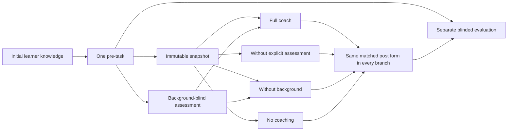

# Adaptive LLM Tutor Simulator

Python implementation of the four-condition simulation in **CS329X Problem Proposal.docx**, following **Adaptive_Tutor_Simulator_Guide.docx**. It runs a learner's pre-task once, freezes the complete state, forks four isolated branches, delivers at most one coaching exercise, and measures behavior on a matched task with new content.

**Status:** the complete offline workflow is implemented. The bundled mocks test experiment plumbing; their scores are not evidence of coaching efficacy or human learning. Live roles use replaceable process adapters, including an optional HTTP bridge. The team's validated RQ1 assessor, human calibration, accepted task rubric, and held-out task bank are still research inputs.

## RQ1 assessment integration (local implementation)

A standalone decision-point assessment pipeline is now available as `tutor-assess`.
See [assessment setup and teammate handoff](docs/assessment.md) for the input/output
contract, frozen v0.2, synthetic examples, independent-reference comparisons, and
participant-disjoint checks. The team example config stays unconfigured
(`configs/assessment.team.example.json`: `model: null`). A locally served
open-weight assessor (Qwen3.8-27B-FP8, with Qwen3.5-9B as a size ablation) is set
up in [docs/local-assessor.md](docs/local-assessor.md), with its pre-declared
protocol and Main 1 results.

The simulation assessor now makes four separate prefix-only calls, without an
oracle opportunity label. It uses the explicitly separate candidate simulation
rubric. The independent outcome evaluator has **not** yet been migrated to
prefix-only packets; its existing full-record exposure remains a research gate.
Use new run directories after these code changes; historical outputs are not
rewritten and should be audited with their original implementation version.

```bash
uv pip install --python .venv/bin/python -e .
.venv/bin/tutor-assess run --items examples/assessment_items.synthetic.jsonl \
  --config configs/assessment.mock.json --output outputs/assessment-final
.venv/bin/tutor-assess audit --run outputs/assessment-final
```

## 1. Quick start

Requires **Python 3.11+**. There are **no runtime or test dependencies** beyond the Python standard library. Run commands from this directory.

### Windows: run immediately with the existing Python installation

This machine has a Python installation managed by `uv`; the `python` shortcut may be a Windows Store placeholder. These commands find the existing interpreter and require neither downloads nor script execution-policy changes:

```powershell
$env:PYTHONPATH = 'src'
$env:PYTHONIOENCODING = 'utf-8'
$simPython = uv --cache-dir .cache/uv python find --offline --no-python-downloads '>=3.11'
& $simPython -m adaptive_tutor validate --config configs/demo.json
& $simPython -m adaptive_tutor run --config configs/demo.json --output outputs/quickstart
& $simPython -m adaptive_tutor audit --output outputs/quickstart
```

When local script execution is allowed, `.\scripts\tutor.ps1` is an optional shortcut for the interpreter and source-path setup. On this machine PowerShell blocks local scripts by default, so the direct commands above are the verified route. On another machine with a working `python` command, use the package or source commands below.

### Install as a package

```bash
python -m venv .venv
# Activate: Windows PowerShell: .\.venv\Scripts\Activate.ps1
# Activate: macOS/Linux: source .venv/bin/activate
python -m pip install -e .
tutor-sim run --config configs/demo.json --output outputs/quickstart
tutor-sim audit --output outputs/quickstart
```

Installing uses setuptools as a build dependency. To run entirely offline without installing, set `PYTHONPATH=src` and use `python -m adaptive_tutor`:

```powershell
$env:PYTHONPATH = 'src'
python -m adaptive_tutor run --config configs/demo.json --output outputs/quickstart
python -m unittest discover -s tests -v
```

On macOS/Linux: `PYTHONPATH=src python -m adaptive_tutor run --config configs/demo.json --output outputs/quickstart`.

The demo should report **1 block, 5 task records, 0 failed branches, 0 failed scores**. The five records are one shared pre-task and four post-tasks. The audit reports `status: passed`. Generated data stays under your chosen output directory.

## 2. Experimental protocol



| Condition | Raw pre-task interaction | Explicit assessment | Background shown to coach | Intervention |
| --- | --- | --- | --- | --- |
| `full` | Yes | Yes | Yes | One bank exercise or none |
| `without_assessment` | Yes | No | Yes | One bank exercise or none |
| `without_background` | Yes | Yes | No | One bank exercise or none |
| `no_coaching` | Retained by learner | Not delivered | Retained by learner | None |

The learner always retains its own initial background and observed history. The coach does not receive a condition label. All coached conditions share the same model, prompt, exercise bank, execution policy and caps. The task agent starts fresh for each task and receives no coaching history. The post-task has task assistance but no further coaching.

Each numeric task uses three learner decision stages:

1. **Request:** the learner receives a goal and is told which data the assistant holds, but no prescribed format and no table values. Whether it states deliverable requirements (B1) and evidence requirements (B2) is up to the learner.
2. **Review:** respond to a controlled task-agent draft; checking the incorrect claim before any disclosure is B3. A learner who names the error and asks for a fix here has performed B4 at this turn, and the agent applies the fix.
3. **Correction:** everyone receives the same arithmetic evidence disclosure before responding; otherwise B4 is measured after that disclosure.

The primary forms use service requests, **100 → 128** with a **35%** draft claim, and library reservations, **200 → 250** with a **20%** draft claim. Correct growth is **28%** and **25%** respectively. AB/BA orientation is configurable and shared by every branch of a block.

**Shared rubric:** RQ2 uses the frozen RQ1 codebook **v0.2** and the evaluated output contract **`decision-point-v2`** for both the assessor and the evaluator, through the same payload builder and quote validator. The tasks were redesigned so that v0.2 opportunities exist: under v0.2, supplied requirements remove B1 and supplied sources remove B2, so the learner's assignment supplies neither and the numeric table stays with the task agent. Shared code does not transfer RQ1 accuracy to simulator dialogues; check the assessor on `data/rq2/v02_fixtures` and on human-labeled simulator records first. See [methodology](docs/methodology.md).

## 3. Code organization

```text
configs/
  demo.json                   One block; four branches; offline
  pilot.json                  Six profiles, four fixture pairs, AB/BA, two samples
  live.example.json           Template requiring actual pinned model IDs
src/adaptive_tutor/
  schema.py                   Typed configuration and strict role-output validation
  profiles.py                 Knowledge-based candidate profile loading
  tasks.py                    Controlled task agent and arithmetic
  learner.py                  Condition-blind learner payloads
  assessment.py               Background-blind RQ1 boundary
  coaching.py                 Input masking and bank selection
  evaluation.py               Blinding, evidence checks, percentage scoring
  runner.py                   Pre-task, snapshots, branch routing, resume
  storage.py                  Atomic checkpoints and hash-chained JSONL
  audit.py                    Offline integrity and routing checks; replay
  analysis.py                 Paired CSVs, cluster intervals, agreement
  cli.py                      Command-line interface
  adapters/                   Mock, JSON process adapter, HTTP bridge
  data/                       Profiles, task forms, exercise bank
  prompts/                    Versioned learner/coach/assessor/evaluator prompts
tests/test_simulator.py        Standard-library integration and contract tests
examples/mock_command_adapter.py
scripts/tutor.ps1              Offline Windows launcher
docs/                         Methodology and team adapter contract
```

Add task forms and profile variants in `data/`; change routing only in the runner and relevant role module. Configurations, bundled data, prompts and Python source hashes are frozen into every output. A changed implementation must use a new output directory.

## 4. Commands and configurations

| Command | Purpose |
| --- | --- |
| `validate --config configs/demo.json` | Check configuration, task keys, splits, families and input contracts; no model calls |
| `run --config configs/demo.json --output outputs/run1` | Start a run or resume the exact same frozen run |
| `audit --output outputs/run1` | Check journal/checkpoint hashes, shared roots, payload masks, score evidence and successful-run caps |
| `replay --output outputs/run1` | Print all visible messages from the validated journal; no model calls |
| `export --output outputs/run1` | Rebuild analysis CSVs and summary from saved records |
| `agreement --reference rater_a.csv --candidate rater_b.csv --save agreement.json` | Raw agreement, unweighted kappa, confusion matrix and false-missed counts |

The larger offline check is:

```powershell
& $simPython -m adaptive_tutor run --config configs/pilot.json --output outputs/pilot
```

It creates **96 blocks, 384 branches and 480 task records**. This includes accurate claims, no-trigger tasks and deliberately incomplete logs. These calibration fixtures must be kept separate from substantive primary-task effect estimates. The uncoached pre-task records provide trajectories for the team's profile review.

Configuration controls profile IDs, task-pair IDs, AB/BA orientations, stochastic replicates, seed, role models, and budgets. Models are fixed by role across conditions. `mode: research` rejects built-in mocks and unedited placeholder IDs; this setting does not certify scientific validity. `require_distinct_families` enforces different declared learner/coach/evaluator families. Use truthful lineage names: family labels are declarations, not independently verified metadata.

All bundled tasks are **development** tasks. A `split: test` run fails until genuine held-out forms are added with that split. Do not relabel development examples as held-out evidence.

## 5. Outputs and traceability

```text
outputs/run1/
  frozen_inputs.json          Configuration, specifications, source/prompt hashes
  events.jsonl                Append-only raw calls, replies, messages and failures
  manifest.json               Private block → condition → blind record mapping
  blocks/<block_id>/
    pre.json                  Shared pre-task record and immutable snapshot
    assessment.json           Explicit pre-task assessment
    block.json                Branch order and outcomes
    branches/<condition>/
      initial_state.json      Shared root hash and distinct session IDs
      result.json             Decision, usage, status, post-task and final state
  blinded/
    <opaque_id>.json           One task record, public inputs, answer key and evidence
    scoring_order.json        Shuffled record IDs
    human_labels_template.csv Blank labels with no condition/profile/model fields
  scores/<opaque_id>.json      Independent outcome labels or recorded failure
  analysis/
    results.csv               Four paired result rows per block, including failures
    behavior_scores.csv       Per-behavior labels, N/A reasons and evidence spans
    summary.json              Paired estimates, usage, failures and limitations
```

Only share `blinded/` with outcome raters. The journal, manifest, scores and analysis files can unblind them. Blinded packets omit profile/group, model/provider, condition, coaching, assessment and pre/post designation, while preserving real task behavior. They use local `m001`-style message IDs. Instructions, sources and authorized answer keys remain available for scoring.

Follow `results.csv` → `pre_record_id` / `post_record_id` → scoring packet → score `evidence_message_ids` and exact `supporting_spans`. `block_id` and `snapshot_hash` link the result back to its shared starting state. Mechanical checks report arithmetic and source-reference validity separately from learner behavior.

## 6. Connect live models and the team's modules

See the full [adapter contract](docs/adapters.md). Each role can use a different executable process, so the validated RQ1 module and coach selection policy can be integrated without changing the runner. All processes receive one JSON request on stdin and return one JSON envelope on stdout. Shell invocation is disabled. Tool use is disabled in protocol v1.

`configs/live.example.json` uses the optional Chat Completions HTTP bridge. Copy it to a new configuration, replace every model/family placeholder, and ensure each command uses an available Python interpreter. Set **four independent role endpoint/key pairs** in your environment, such as `TUTOR_LEARNER_URL` and `TUTOR_LEARNER_API_KEY`; repeat for `ASSESSMENT`, `COACH` and `EVALUATOR`. Keep credentials out of configuration and logs. The bridge does not load `.env` files automatically.

The bridge uses JSON mode, `max_completion_tokens`, and provider usage counts according to the [official Chat Completions API reference](https://developers.openai.com/api/reference/resources/chat/subresources/completions/methods/create). Compatibility with other providers must be checked in their adapters; different model families do not necessarily expose the same API. Select exact accessible model IDs after pilot testing. Aliases that resolve to a different returned ID fail the pinning check. Models must support the configured parameters, including temperature and JSON mode; unsupported settings are recorded as failures.

The standalone real-log assessor uses the preserved frozen v0.2 protocol. The simulation assessor/evaluator rubric and exercises remain candidate implementations. Replace and version them after team validation. No API credentials or paid calls were used to validate this repository.

## 7. Scoring and analysis

Labels are **2** (performed), **1** (partial), **0** (missed with an opportunity), or JSON **null** (N/A). Null requires `no_opportunity` or `insufficient_evidence`; it never becomes zero. Non-null labels require real message IDs and exact supporting spans, and cannot cite turns after their decision point.

```text
task percentage = 100 × sum(non-null labels) / (2 × number of scorable behaviors)
gain (percentage points) = post percentage − shared pre percentage
paired effect = coached gain − no-coaching gain from the same block
```

An all-N/A task has no defined percentage. Its CSV score cells are blank. `pre_scorable`, `post_scorable`, `na_reasons`, and `comparable_effect_pp` expose denominator differences. Failed tasks/scores stay unavailable rather than becoming learner errors. A paired estimate requires both branch scores and the shared pre-score. Summaries report failure counts and available paired blocks explicitly.

Task-pair cluster bootstrap intervals keep repeated observations and sibling branch relationships together. The one primary pair is insufficient for a task-generalization interval, so its interval is null. Calibration fixtures in `pilot.json` are not independent substantive domains and must not be used to claim task generalization. See [analysis assumptions](docs/methodology.md#analysis-and-human-review).

For human agreement, copy `human_labels_template.csv` separately for two independent raters and fill `label` with `0`, `1`, `2`, or literal `N/A`. Compare matching subsets before adjudication. Keep adjudicated labels in a third file. The tool rejects mismatched item sets and duplicate decision points. Kappa is null when its denominator is undefined.

## 8. Resume, budgets and failure handling

- Repeat the same `run` command and output path to resume. Completed calls are reused by stable call ID and exact request hash; completed/failed branches and scores are retained. Valid responses are never regenerated to obtain a more convenient outcome.
- Interrupted work rebuilds from accepted responses in the journal. A provider call that finished remotely but was interrupted before its response was recorded may be retried; exactly-once remote execution is not guaranteed.
- Only transport failures are retried, under a fixed attempt cap and backoff. Exit code 75 identifies retryable failures for process adapters. Invalid JSON, bad evidence, model mismatch and budget overruns are terminal.
- One coaching turn means one delivered coach message followed by one accepted learner reply. Selection tokens and learner practice input/output tokens count toward the coaching budget. Fixed bank messages are logged but have no model generation usage of their own.
- Model output caps are sent to the adapter. The runner validates returned counts and marks over-budget responses failed. Remote input tokens and transport failures can incur costs before counts are known: the total token cap is an acceptance limit, not a guaranteed provider billing limit. Overruns are retained in actual usage; usage for transport failures without a response is reported as unknown.
- Context has a byte limit and is never silently truncated. Exhausted/incomplete work is visible. The HTTP bridge disables redirects and takes secrets only from the environment.
- The run directory has a single-writer lock. After a hard crash, remove `.run.lock` only after confirming its process has exited. A truncated or corrupted journal fails auditing; preserve it instead of editing historical events.

Exit status is **0** for success, **1** for an experiment with failed branches/scores, and **2** for an invalid command/configuration or an integrity error. An audit may pass on a faithfully recorded failed experiment; inspect the failure counts too.

## 9. Tests and research handoff

```powershell
$env:PYTHONPATH = 'src'
python -m unittest discover -s tests -v
```

Tests cover shared snapshots and mutation isolation, exact condition masks, answer-key exclusion, counterbalancing, standardized disclosure, missing opportunities, score evidence, N/A arithmetic, paired exports, independent sessions, fixed retries, process adapters, failure preservation, interruption/resume and offline replay. New RQ1 regressions additionally verify prefix-only input (not just quote validation), oracle-status exclusion, separate behavior calls, failure-versus-N/A handling, blank model configuration and participant-disjoint guards.

Local verification on **2026-10-27**, using Python 3.12: **29 tests passed**. The final [demo manifest](outputs/final-demo/manifest.json) contains one block and five task records; the [pilot manifest](outputs/final-pilot/manifest.json) contains 96 blocks and 480 records. Both completed with zero failed branches and zero failed scores. These generated, ignored output directories are available in this workspace; a fresh checkout recreates them with the commands above.

Before a substantive study, the team needs to accept the simulator rubric adaptation, review uncoached profile fidelity, validate the RQ1 and outcome evaluators against independent humans, freeze a shared exercise bank, add held-out pairs, select accessible pinned models and preregister thresholds/contrasts/failure handling. A second evaluator can score the same `blinded/` packets through the documented contract; keep its outputs separate. Model family separation is one safeguard and does not establish unbiased evaluation.

The simulator measures **immediate transfer within retained conversational context**. It does not simulate changes to model weights or establish durable human learning. The mocks intentionally ignore profile rank and do not implement a learning curve. The scripted task agent and mock scorer use limited lexical rules; free-form semantic evaluation belongs in the independent live evaluator and human review.
